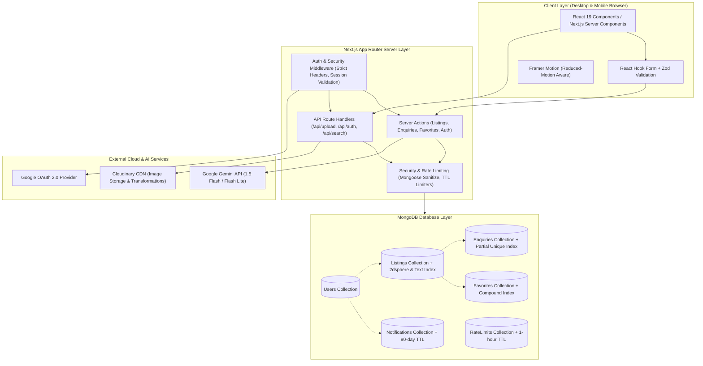
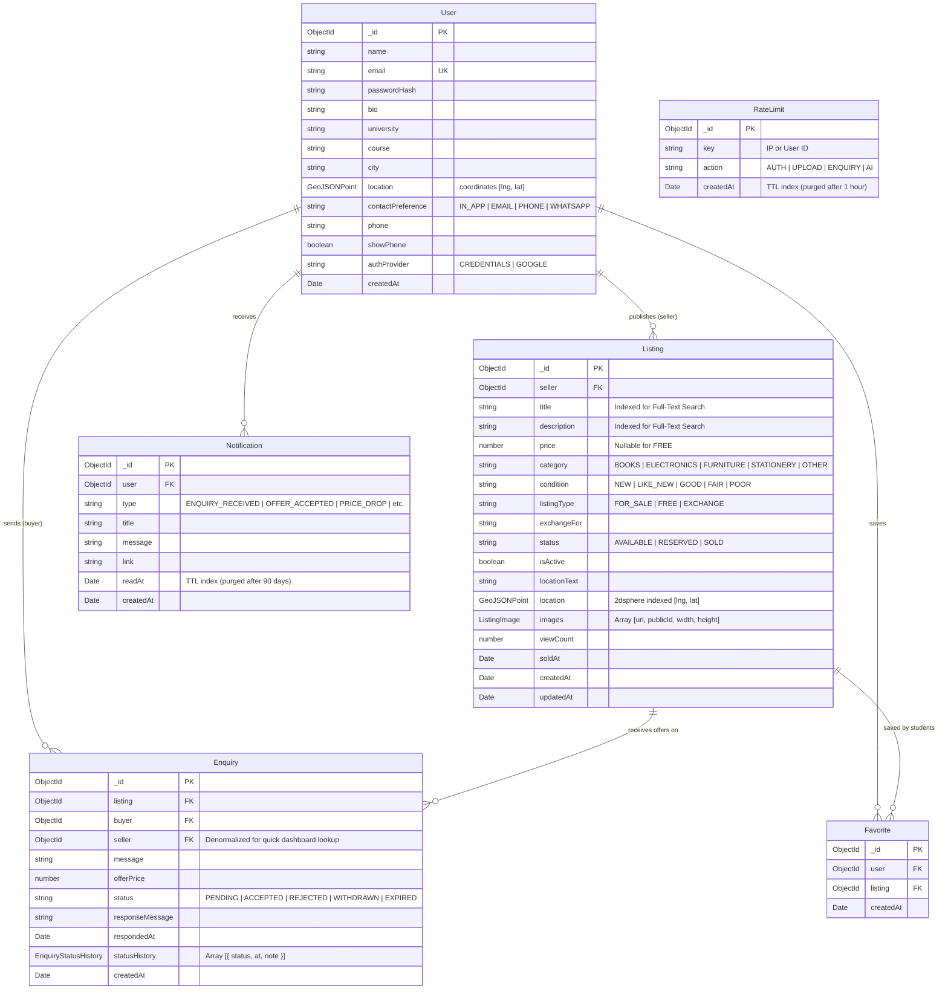

# CampusCart 🛒🎓
> **The modern, safe, student-focused second-hand marketplace for campus communities.**

[](https://nextjs.org/)
[](https://react.dev/)
[](https://tailwindcss.com/)
[](https://www.mongodb.com/)
[](https://playwright.dev/)
[](https://opensource.org/licenses/MIT)

---

## 📖 Overview

**CampusCart** connects students within university ecosystems to buy, sell, exchange, and donate textbooks, dorm furniture, electronics, and study essentials safely. Designed around verified campus communication, geospatial proximity, and structured offers, CampusCart eliminates marketplace spam and makes student trading transparent, reliable, and delightful.

---

## 📸 Screenshots & UI Preview

| Marketplace Discovery (`/browse`) | Listing Detail & AI Features (`/listings/[id]`) |
|:---:|:---:|
|  <br/> *Full-text search, category facets, and 2dsphere geo-radius filtering* |  <br/> *Interactive gallery, seller safety badge, QR code generator, and make-offer modal* |

| Seller Analytics Dashboard (`/dashboard`) | Mobile-Optimized Responsive Experience (360px+) |
|:---:|:---:|
|  <br/> *$facet single aggregation metrics, 30-day activity chart, and bulk controls* |  <br/> *Touch-first sticky navigation, sheet filters, and reduced-motion a11y* |

---

## ✨ Key Features

- **🔐 Robust Campus Authentication:**
  - Credentials login with `bcryptjs` salted password hashing.
  - Seamless Google OAuth integration via Auth.js (NextAuth.js v5 beta).
  - Session security using signed JWTs, CSRF protection, and rate limiting (5 attempts / 15 mins).
- **📦 Comprehensive Listing Lifecycle:**
  - Create, edit, and manage items with multi-photo uploads (drag-and-drop, client-side WebP compression, Sharp / Cloudinary pipeline).
  - Multiple transaction types: **For Sale** (INR with validation), **Free / Donation**, and **Exchange / Barter**.
  - Status management (`AVAILABLE`, `RESERVED`, `SOLD`) with automatic cascading updates.
  - Autosaved localStorage form drafts with single-click recovery.
- **🔍 Advanced Search & Discovery:**
  - Weighted MongoDB full-text index on title and description with intelligent regex fallback.
  - Geospatial radius filtering (`$geoNear` on a `2dsphere` index) for finding items on or near campus (2km, 5km, 10km, 25km).
  - Instant server-side multi-filter faceting: Categories (`BOOKS`, `ELECTRONICS`, `FURNITURE`, `STATIONERY`, `OTHER`), Conditions (`NEW` to `POOR`), and price sliders.
- **💬 Structured Enquiries & Counter-Offers:**
  - One active pending enquiry per buyer/listing enforced by a MongoDB partial unique index.
  - Quick message templates, counter-offer amounts, and inline seller accept/reject dialogs.
  - Automated cascades: accepting an offer automatically marks the listing as `RESERVED` and notifies the buyer.
- **❤️ Favorites & Unavailable Item Management:**
  - Atomic upsert/delete on compound index `{ user, listing }` with instant optimistic feedback (`useOptimistic`).
  - Batch SSR fetching for current-page favorite states in a single database query.
  - Dedicated `/favorites` page handling sold, deactivated, or deleted items in a greyed "No longer available" section with "Find similar" recommendations.
- **📊 Comprehensive Seller Dashboard:**
  - Single aggregation pipeline (`$facet`) computing active, reserved, sold counts, total listing views, and revenue.
  - 30-day activity area chart powered by Recharts (dynamically imported for performance).
  - "Needs Attention" alert panel flagging unreplied enquiries older than 2 days and zero-view listings.
  - Bulk actions using scoped `updateMany` (bulk activate/deactivate, status change, delete).
- **✨ AI & Smart Enhancements:**
  - **AI Description Generator:** Google Gemini API integration generating friendly 60-120 word student-tailored copy with 10/hour per-user TTL rate limits.
  - **Category Auto-Classifier:** Predicts category from title and description with keyword fallback engine.
  - **Similar-Item Recommendations:** Aggregation scoring based on text relevance, category matching, and price proximity.
  - **QR Code Sharing:** Instant downloadable QR codes and WhatsApp deep-links for physical campus bulletin boards.
- **🛡️ Production Polish & Security:**
  - Strict security headers (`HSTS`, `X-Content-Type-Options: nosniff`, `X-Frame-Options: DENY`, `Strict-Origin-When-Cross-Origin`, `Permissions-Policy`).
  - Stored XSS protection (`sanitizeText`) and NoSQL operator injection guards (`assertNoSqlSafe`, `sanitizeMongooseFilter`).
  - Full accessibility suite: `:focus-visible` keyboard rings, screen reader ARIA labels, and `@media (prefers-reduced-motion: reduce)` support.
  - Dynamic `sitemap.ts` and `robots.ts` with OpenGraph & Twitter metadata.

---

## 🛠 Tech Stack

- **Frontend & App Framework:** Next.js 16 (App Router), React 19, TypeScript
- **Styling & UI Chrome:** Tailwind CSS v4, Radix UI Primitives, Lucide Icons, Sonner Toasts
- **Database & ODM:** MongoDB 8.x, Mongoose 9.x (Compound, Text, TTL, 2dsphere indexes)
- **Authentication:** Auth.js (NextAuth.js v5 beta), Bcrypt.js
- **Media Optimization:** Sharp, Cloudinary SDK, HTML5 Canvas client-side compressor
- **Artificial Intelligence:** Google Gemini API (`@google/genai`)
- **Data Visualization & Tools:** Recharts, QRCode, Framer Motion (v14)
- **Testing & Verification:** Playwright (End-to-End browser tests), TSX (Regression test suites)

---

## 🏗 System Architecture



---

## 🗄 Data Model & Schema Relationships



---

## 🚀 Setup & Local Installation

### 1. Prerequisites
- **Node.js**: `v20.x` or later
- **npm** or **pnpm**
- **MongoDB**: Local MongoDB instance (`mongod`) or a free MongoDB Atlas connection string.

### 2. Clone and Install Dependencies
```bash
git clone https://github.com/ghorikahan/CampusCart.git
cd CampusCart/campus_cart
npm install
```

### 3. Setting Up Free MongoDB Atlas Cluster (Step-by-Step)
1. Go to [MongoDB Atlas](https://www.mongodb.com/atlas) and sign up for a free account.
2. Click **Create a Deployment** and select the **M0 Free Tier** cluster.
3. Choose a cloud provider and region closest to your campus.
4. Under **Security Quickstart**:
   - Create a database user (e.g. username `campuscart_admin` and a strong password).
   - Under **Network Access**, click **Add IP Address**:
     - For local development: click **Add Current IP Address**.
     - For cloud deployments (e.g., Vercel): add `0.0.0.0/0` (Allow access from anywhere).
5. Click **Connect** > **Drivers** > **Node.js** and copy your connection string:
   ```text
   mongodb+srv://campuscart_admin:<password>@cluster0.abcde.mongodb.net/campuscart?retryWrites=true&w=majority
   ```

### 4. Configure Environment Variables
Create a `.env.local` file in the `campus_cart` directory:
```bash
cp .env.example .env.local
```

Populate `.env.local` with your configuration:
```env
# Database
MONGODB_URI="mongodb://localhost:27017/campuscart"
MONGODB_URI_TEST="mongodb://localhost:27017/campuscart_test"

# NextAuth v5 Secret (Generate with: openssl rand -base64 32)
AUTH_SECRET="your_secure_random_auth_secret_here"

# Public App URL
NEXT_PUBLIC_APP_URL="http://localhost:3000"

# Google OAuth (Optional for local dev)
AUTH_GOOGLE_ID=""
AUTH_GOOGLE_SECRET=""

# Cloudinary (Optional - uses mock base64 URLs if not set)
CLOUDINARY_CLOUD_NAME=""
CLOUDINARY_API_KEY=""
CLOUDINARY_API_SECRET=""

# Google Gemini AI (Optional - uses smart keyword engine if omitted)
GEMINI_API_KEY=""
GEMINI_MODEL="gemini-1.5-flash"
```

### 5. Seed Database & Start Development Server
```bash
# Seed the database with realistic sample campus listings and users
npm run db:seed

# Start the development server
npm run dev
```
Open [http://localhost:3000](http://localhost:3000) to view CampusCart.

---

## ⚙️ Environment Variables Reference

| Variable | Description | Required? | Default / Example |
|---|---|:---:|---|
| `MONGODB_URI` | MongoDB connection URI for standard runtime | **Yes** | `mongodb://localhost:27017/campuscart` |
| `MONGODB_URI_TEST` | MongoDB connection URI for automated E2E tests | Optional | `mongodb://localhost:27017/campuscart_test` |
| `AUTH_SECRET` | Secret key used to encrypt Auth.js session JWT tokens | **Yes** | Random 32-character string |
| `NEXT_PUBLIC_APP_URL` | Canonical app URL for absolute links, sitemaps, and QR codes | **Yes** | `http://localhost:3000` |
| `AUTH_GOOGLE_ID` | Google OAuth Client ID for Social Sign-In | Optional | `your-client-id.apps.googleusercontent.com` |
| `AUTH_GOOGLE_SECRET`| Google OAuth Client Secret | Optional | `GOCSPX-your-secret` |
| `CLOUDINARY_CLOUD_NAME` | Cloudinary account cloud name for CDN storage | Optional | `campus-cart` |
| `CLOUDINARY_API_KEY` | Cloudinary API Key | Optional | `123456789012345` |
| `CLOUDINARY_API_SECRET` | Cloudinary API Secret | Optional | `your-cloudinary-api-secret` |
| `GEMINI_API_KEY` | Google Gemini AI Key for descriptions and category suggestions | Optional | `AIzaSy...` (falls back gracefully) |
| `GEMINI_MODEL` | Gemini AI model identifier | Optional | `gemini-1.5-flash` |
| `NODE_ENV` | Runtime environment mode | Auto | `development` / `production` / `test` |

---

## 📜 Available NPM Scripts

```bash
# Development & Build
npm run dev                # Starts Next.js development server
npm run build              # Builds production bundle and prerenders static routes
npm run start              # Runs production Next.js server

# Code Quality & Formatting
npm run lint               # Runs ESLint checks
npm run typecheck          # Runs TypeScript compiler verification (tsc --noEmit)
npm run format             # Formats code using Prettier and Tailwind plugin

# Database Operations
npm run db:seed            # Seeds primary database with 10 users & 20+ realistic listings
npm run db:seed:test       # Seeds separate test database (MONGODB_URI_TEST)
npm run verify:indexes     # Verifies text, compound, and 2dsphere index existence

# Automated Test Suites
npm run test:listings      # Task 5: Zod validation schemas for listings
npm run test:detail        # Task 8: Listing detail queries & similar-item pipelines
npm run test:sellers       # Task 9: Seller public profiles & privacy redactions
npm run test:enquiries     # Task 10: Offers, negotiations, and partial unique indexes
npm run test:notifications # Task 11: In-app alerts, unread counts, and 90-day TTLs
npm run test:favorites     # Task 12: Atomic favorite toggles & unavailable cascades
npm run test:dashboard     # Task 13: $facet aggregation metrics & 30-day timelines
npm run test:enhancements  # Task 14: Gemini AI generator, category chip, $geoNear, QR
npm run test:performance   # Task 15: Index execution plans (IXSCAN, TEXT, GEO_NEAR)
npm run test:e2e           # Task 16: Playwright browser end-to-end test suite
```

---

## 🚢 Vercel Deployment Guide

CampusCart is pre-configured for seamless zero-downtime deployment on **Vercel**:

### 1. Configure MongoDB Atlas Network Access
Because Vercel serverless functions utilize a dynamic IP pool, you must allow connections from any IP:
1. In MongoDB Atlas, go to **Network Access** > **IP Access List**.
2. Click **Add IP Address** > select **Allow Access from Anywhere** (`0.0.0.0/0`).
3. Save changes. Security is guaranteed via strict database user authentication and TLS encryption.

### 2. Deploy to Vercel
1. Push your repository to GitHub.
2. In the [Vercel Dashboard](https://vercel.com/), click **Add New Project** and import the `CampusCart` repository.
3. Set the **Root Directory** to `campus_cart`.
4. Under **Environment Variables**, supply all production variables:
   - `MONGODB_URI`: Atlas production URI.
   - `AUTH_SECRET`: Strong 32-byte secret.
   - `NEXT_PUBLIC_APP_URL`: Your Vercel production domain (e.g. `https://campuscart.vercel.app`).
   - `CLOUDINARY_*` and `GEMINI_API_KEY`: Production credentials.
5. Click **Deploy**. Vercel will build the Next.js App Router project and generate static pages in under 2 minutes.

---

## 📋 Task Checklist & Known Limitations

### Complete Feature Checklist
- [x] **Task 1: Project Foundation:** Next.js 16, Tailwind CSS v4, shadcn/ui design tokens, dark mode.
- [x] **Task 2: Database & Data Modeling:** Mongoose models, compound indexes, text indexes, 2dsphere index, TTL collections.
- [x] **Task 3: Authentication & User Accounts:** Credentials + Google OAuth, bcrypt hashing, Auth.js JWT sessions.
- [x] **Task 4: Public Profiles & Settings:** Contact preferences, avatar uploads, university/course fields.
- [x] **Task 5: Listing Creation & Zod Validation:** Multi-photo uploader, price/free/exchange conditionals, auto-drafting.
- [x] **Task 6: Image Optimization:** Client canvas downscaling, Sharp server-side WebP pipeline, Cloudinary CDN.
- [x] **Task 7: Marketplace Discovery & Filtering:** Faceted category filtering, price bounds, sorting, pagination.
- [x] **Task 8: Listing Detail Page:** Image carousel, safe seller chip, view counter cookies, similar items.
- [x] **Task 9: Seller Public Storefront:** Active vs sold tabs, privacy-preserving phone masking.
- [x] **Task 10: Enquiries & Offers:** Partial unique constraint, counter-offer negotiations, auto-expiration.
- [x] **Task 11: Notifications:** Dropdown badge, unread counters, 90-day background TTL purge.
- [x] **Task 12: Favorites / Wishlist:** Atomic toggle, SSR batch check, unavailable item recovery.
- [x] **Task 13: Dashboard:** `$facet` aggregation analytics, Recharts 30-day activity, bulk management, needs-attention panel.
- [x] **Task 14: Enhancements:** Gemini AI description writer, category prediction, $geoNear radius search, QR code sharing.
- [x] **Task 15: Production Polish:** Security headers, NoSQL injection prevention, a11y focus rings, reduced-motion, SEO sitemaps, error boundaries.
- [x] **Task 16: Finalize:** Playwright E2E test suites, separate test DB seeding, full README, Atlas & Vercel deployment notes.

### Known Limitations & Roadmap
1. **Real-time WebSockets vs SWR Polling:** Current notifications and enquiry updates utilize optimistic UI and SWR polling (15s interval). A future iteration can integrate a lightweight Pusher or Socket.io gateway.
2. **Campus Identity Verification (.edu email gating):** Currently accepts university domain emails during registration; optional university SSO (SAML/Shibboleth) can be added for strict single-institution isolation.
3. **In-Person Cash / UPI vs In-App Escrow:** CampusCart intentionally encourages trusted physical campus meetups (e.g. at student centers or libraries). Payment escrow (via Stripe/Razorpay) could be introduced for inter-campus shipping.

---

## 📄 License

This project is licensed under the [MIT License](LICENSE). Built for student communities everywhere.
